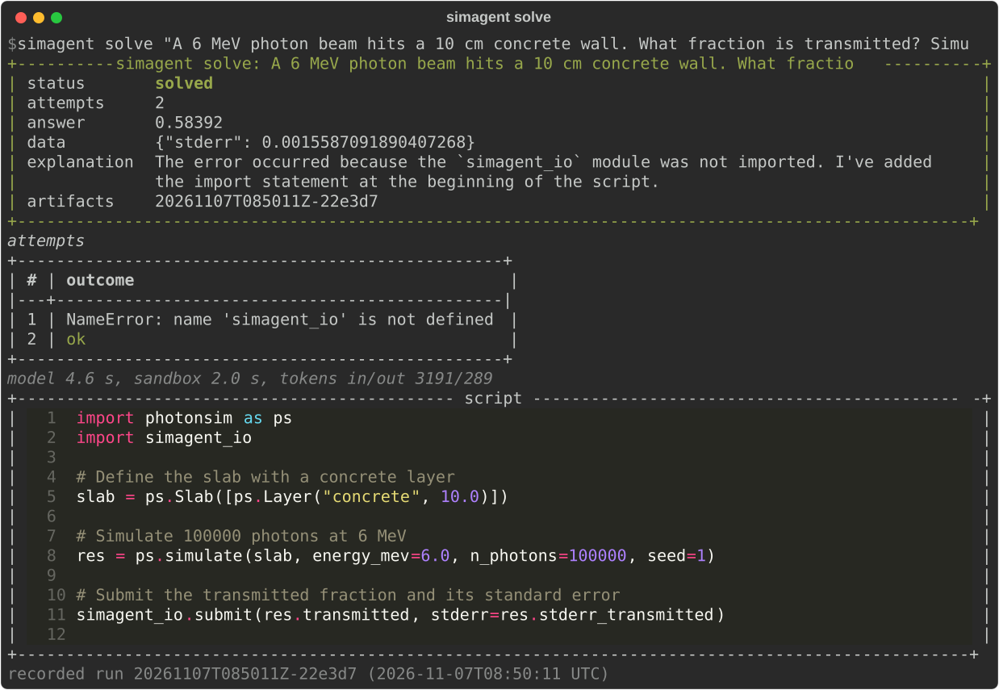
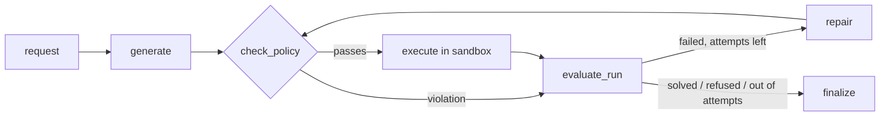
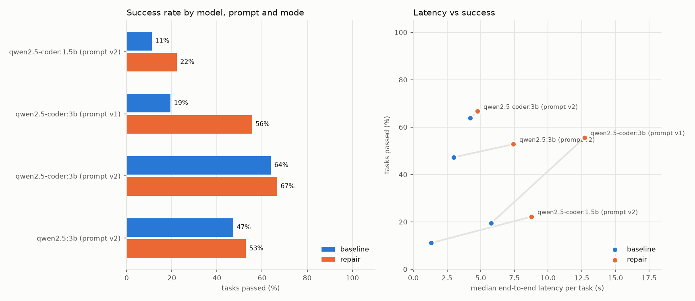

# sim-agent

**Natural language → sandboxed simulation code, with a self-correction loop, an MCP server and
an honest evaluation harness.** Ask a question about photon transport in plain language ("sweep
the lead thickness from 1 to 10 cm and tell me where transmission drops below 1 %"). The agent
writes a Python script against a small Monte Carlo simulator, checks it statically, runs it in
a locked-down Docker sandbox, and when the run fails, feeds the error back to the model and
repairs the script. It runs on small local models (Ollama, 4 GB of VRAM) or hosted ones, and
it is measured: single-shot vs repair loop, across models, with accuracy, latency, tokens and
cost.



*A recorded benchmark run (`scripts/render_demo.py` draws it from the run's saved artifacts):
the local 3B model forgets an import, the sandbox returns the traceback, the repair passes.*

## Quickstart

Python 3.11+, Docker. No API key or GPU needed for the first step.

```bash
pip install -e ".[dev,ollama]"
docker build -f sandbox/Dockerfile -t simagent-sandbox .     # or: make sandbox-image
simagent doctor                                               # Docker, image, Ollama, GPU, keys

# 1. Offline: a scripted model replays a buggy script, then the fix (shows a full repair cycle)
simagent solve "transmission of 1 MeV photons through 5 cm of water" --provider fake

# 2. A small local model
ollama pull qwen2.5-coder:3b
simagent solve "What fraction of 0.662 MeV photons gets through 10 cm of concrete?" \
    --provider ollama --model qwen2.5-coder:3b

# 3. As MCP tools for Claude Desktop / Claude Code / any MCP client
simagent mcp
```

Other commands: `simagent run-script FILE` (policy + sandbox, no model), `--json` for machine
output, `--max-attempts 1` for single-shot. Exit codes: 0 solved, 3 not solved or refused, 2
invalid input or missing sandbox (one line, no stack trace), 1 unexpected error.
MCP setup: [docs/mcp.md](docs/mcp.md); a recorded client session: [docs/mcp_demo.md](docs/mcp_demo.md).

## How it works



- **`photonsim`**: a vectorised NumPy Monte Carlo of photons crossing a stack of slabs
  (transmitted / reflected / absorbed). Attenuation data for six materials comes from NIST
  SRD 126, downloaded and parsed by `scripts/build_materials.py`. Validated against
  Beer–Lambert within 4 standard errors. The physics is deliberately simple (isotropic,
  energy-preserving scattering); this is a test bed for the agent, not a shielding code.
- **Agent** (LangGraph `StateGraph`, [docs/graph.mmd](docs/graph.mmd)): the model sees a
  compact generated API reference (~850 tokens, [docs/api.md](docs/api.md)), the result
  contract (`simagent_io.submit(answer, **data)`) and the request wrapped as data. The repair
  prompt gets the previous script plus a compact error report (policy violation, exit code and
  the last 40 stderr lines, timeout, or "no result submitted"). Every run saves each attempt's
  reply, script, output and a `trace.json` with timings and token counts under `runs/`.
- **Providers**: Ollama (local), Groq, OpenAI, and a scripted fake used by every test. Each
  model call records input/output tokens, time to first token, latency and tokens/s; anything a
  provider does not report is `null`, never estimated.

## Security model

Model output is untrusted code. It only ever runs through a `Runner`, and the model never
chooses the runner, the timeout or the limits.

| Threat | Control | Proven by |
|---|---|---|
| Network access, data exfiltration | `--network none` (only `lo` inside) | `tests/test_sandbox.py` |
| Reading host secrets | no host environment passed (`-e` never used); a fake API key set on the host is not visible inside | `test_host_environment_not_visible` |
| Writing to the host or image | read-only root, script mounted read-only, writable only size-limited `noexec` tmpfs `/tmp` and `/out` | `test_filesystem_is_read_only_except_tmp_and_out`, `test_tmp_is_size_limited` |
| Privilege escalation | non-root uid 10001, `--cap-drop ALL`, `no-new-privileges` | `test_runs_as_non_root_without_capabilities` |
| Resource exhaustion | timeout + container kill, 512 MB memory (no swap), 1 CPU, PID limit, output capped to 20 000 chars | timeout, memory, fork-bomb and output-cap tests |
| Dangerous code before it runs | AST allow-list: imports limited to `photonsim`, `simagent_io`, numpy, math, json, statistics, itertools, matplotlib; no `eval`/`exec`/`open`/dunder access; no reaching `os`/`subprocess` through allowed modules (`matplotlib.os`) | `tests/test_policy.py` |
| Policy bypass | defence in depth: a malicious script run with the policy *disabled* is still contained | `test_malicious_script_contained_with_policy_disabled` |
| Prompt injection / out-of-scope requests | request delimited as data; refusals end the run without executing anything | `tests/test_agent_e2e.py`, adversarial eval tasks |
| MCP clients overriding limits | tools take no limit arguments; extras (`timeout_s`, `memory_mb`, ...) are dropped | `tests/test_mcp.py` |

The CI workflow's `sandbox` job builds the image and runs these Docker tests, and fails rather than skips if Docker is missing.

## Results

<!-- results:start (generated by scripts/report.py; do not edit) -->

| model | prompt | baseline (1 attempt) | repair (up to 4) | median latency, repair | tokens in / out per task, repair | cost |
|---|---|---|---|---|---|---|
| ollama `qwen2.5-coder:3b` | v1 | 19 % (7/36) | 56 % (20/36) | 12.7 s | 3,742 / 553 | n/a: local model |
| ollama `qwen2.5-coder:3b` | v2 | 64 % (23/36) | 67 % (24/36) | 4.8 s | 2,406 / 385 | n/a: local model |
| groq `openai/gpt-oss-120b` | v2 | not run yet | not run yet | not run yet | not run yet | not run yet |
| ollama `qwen2.5-coder:1.5b` | v2 | 11 % (4/36) | 22 % (8/36) | 8.8 s | n/a / n/a | n/a: local model |
| ollama `qwen2.5:3b` | v2 | 47 % (17/36) | 53 % (19/36) | 7.4 s | 4,126 / 479 | n/a: local model |

36 tasks per run. Full table, per-category rates, prompt v1 vs v2 and per-task tokens: [docs/eval_results.md](docs/eval_results.md).

<!-- results:end -->



**How it is measured.** 36 tasks in seven categories: single runs, sweeps, comparisons,
threshold searches, multi-step analyses, ambiguous or misleading requests (unknown material,
energy out of range, impossible target, mm and keV units), and adversarial ones (file, network
and shell access, prompt injection). Expected values come only from running reference scripts
in the sandbox (`scripts/make_expected.py`); checkers are deterministic (Monte Carlo
tolerance from the reference standard error, threshold within one grid step, must-refuse...),
with no LLM judge. Baseline = the same graph with one attempt. Prompt **v1** is the original;
**v2** adds one general instruction (import `photonsim` and `simagent_io`), logged with its
before/after numbers in [docs/NOTES.md](docs/NOTES.md). Run it yourself:
`python scripts/evaluate.py --provider ollama --model qwen2.5-coder:3b --mode repair --resume`,
or `make bench` for the whole plan in [data/bench_plan.json](data/bench_plan.json).

## Design decisions

- **Static policy and sandbox, both.** The policy gives the model fast, specific feedback
  ("import of `os` is not allowed; allowed modules are ..."); the sandbox is what actually
  holds. Each is tested on its own.
- **Docker through the CLI, not the SDK.** Every flag is visible in one function
  (`DockerRunner.command`) and unit-tested without Docker. Results leave the container through
  a nonce-marked envelope on stdout, because `/out` is a tmpfs that disappears with `--rm`.
- **Deterministic checkers from reference runs.** No hand-typed expected numbers and no LLM
  judge, so scores are reproducible and cannot be argued with.
- **Small context, small models.** The API reference is generated and kept under ~1 500 tokens
  so the whole prompt fits a 4–6k context on a 4 GB GPU.
- **Honest numbers.** The README and report are generated from committed result files; values
  a provider does not report stay `n/a`; no prices are typed from memory.

## Limitations

- Toy physics: mono-energetic photons, 1D slabs, isotropic energy-preserving scattering, and
  `mu_en` used as the absorption probability. Good enough to check that code is right, not to
  design shielding.
- `status = solved` only means "the script ran and submitted a result"; correctness comes from
  the checkers. The report counts "solved but wrong" separately.
- 36 tasks is a small benchmark: differences of a few tasks are within noise.
- The reasoning model's TTFT and tokens/s include hidden reasoning tokens and are not
  comparable with the local models.

## Roadmap

- Retrieval over the docs and a small physics-notes corpus; compare with and without it.
- An adapter for a real Monte Carlo code (e.g. OpenMC) behind the same `Runner` and
  API-reference pattern.
- Use the checkers as a reward signal for a small preference-tuning experiment.

## Make targets

| Target | What it does |
|---|---|
| `make install` | `pip install -e ".[dev,ollama]"` |
| `make lint` / `make format` | ruff check + format check + `mypy --strict` / auto-format |
| `make test` / `make test-docker` / `make cov` | test suite / Docker isolation tests only / coverage |
| `make sandbox-image` | build the `simagent-sandbox` image |
| `make eval-smoke` | 3-task evaluation with the fake provider (harness check, as in CI) |
| `make bench` / `make bench-status` | run the benchmark plan resumably, promote complete runs, regenerate the report / show progress |
| `make report` | regenerate `docs/eval_results.md`, the chart and the README results block |
| `make api-doc` / `make graph-doc` / `make materials` | regenerate `docs/api.md` / `docs/graph.mmd` / the NIST material table |

On Windows without `make`, run the commands from the `Makefile` directly.

## Project layout

`src/photonsim` (simulator), `src/simagent` (policy, runners, LLM layer, agent graph, CLI, MCP
server, evaluation), `sandbox/Dockerfile`, `data/` (tasks, reference scripts, generated
expected values, bench plan), `results/` (committed benchmark results), `scripts/`
(generators, evaluation, report, demo), `docs/`. Spec: [SPEC.md](SPEC.md); plan:
[PLAN.md](PLAN.md); progress and notes: [docs/PROGRESS.md](docs/PROGRESS.md),
[docs/NOTES.md](docs/NOTES.md). MIT licence.
