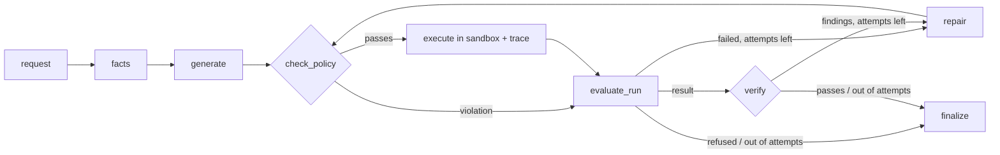
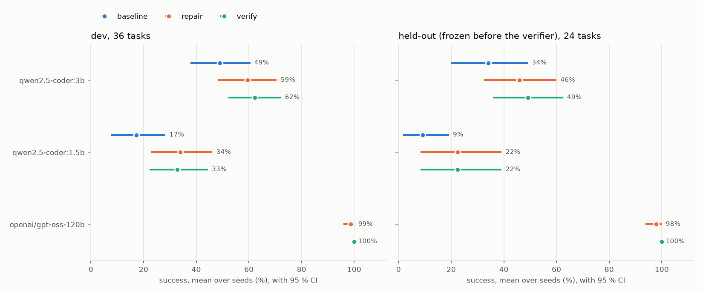

# sim-agent

[](https://github.com/JMJJ-projects/sim-agent/actions/workflows/ci.yml)

**Natural language → sandboxed simulation code, with a repair loop, a verifier, an MCP server and
an evaluation harness.** Ask a question about photon transport in plain language ("sweep the lead
thickness from 1 to 10 cm and tell me where transmission drops below 1 %"). The agent writes a
Python script against a small Monte Carlo simulator, checks it statically, runs it in a
locked-down Docker sandbox, repairs it when it fails, and **verifies the answer against the
request and a trace recorded by the simulator itself** before returning it.

**The question this repo answers: what actually helps a small local model on a 4 GB GPU?**
Measured over 60 tasks (24 of them held out, frozen before the verifier was written), several
seeds, with 95 % confidence intervals:

- **A bigger model, even half on the CPU, helps most:** the 7B coder at Q4 beats the 3B coder by
  16.5 pp (dev) and 21.7 pp (held-out), at about 3.3x the latency.
- **The repair loop helps:** +10.6 / +11.7 pp for the 3B model, +16.7 / +13.3 pp for the 1.5B.
- **Verification helps much less than it catches:** it flags wrong answers with few false
  alarms, but the small model rarely fixes them: +3.3 pp on held-out for the 3B model, no
  measurable difference in the three other local comparisons.
- **Q8 instead of Q4: no measurable difference.** And the refusal rule added to the repair
  prompt (v3) caused false refusals after ordinary crashes, with no adversarial gain.


*A recorded v2 benchmark run of the local 3B model in `verify` mode (temperature 0.7, seed 4;
`scripts/render_demo.py` draws it from the run's saved artifacts): the first script crashes on a
missing import; the second runs but simulates the wrong lead thickness, which the verifier catches
from the simulator's trace (V-LENGTH); the third is correct.*

## Quickstart

Python 3.11+, Docker. No API key or GPU needed for the first step.

```bash
pip install -e ".[dev,ollama]"
docker build -f sandbox/Dockerfile -t simagent-sandbox:2 .   # or: make sandbox-image
simagent doctor                                               # Docker, image, Ollama, GPU, keys

# 1. Offline: a scripted model replays a crash, then a script that runs but uses the wrong
#    unit (caught by verification), then the fix
simagent solve "transmission of 1 MeV photons through 5 cm of water" --provider fake

# 2. A small local model
ollama pull qwen2.5-coder:3b
simagent solve "What fraction of 0.662 MeV photons gets through 10 cm of concrete?" \
    --provider ollama --model qwen2.5-coder:3b

# 3. As MCP tools for Claude Desktop / Claude Code / any MCP client
simagent mcp
```

Other commands: `simagent run-script FILE` (policy + sandbox, no model), `--json` for machine
output, `--mode baseline|repair|verify` (default `verify`: the repair loop plus checking the
answer against the request and the simulation trace), `--max-attempts 1` for single-shot.
Exit codes: 0 solved, 3 not solved, refused or answered but unverified, 2
invalid input or missing sandbox (one line, no stack trace), 1 unexpected error.
MCP setup: [docs/mcp.md](docs/mcp.md); a recorded client session: [docs/mcp_demo.md](docs/mcp_demo.md).

## How it works



- **Facts and verifier** (v2): `facts` extracts what the request states (units, energies,
  thicknesses, lists, counts, materials) with deterministic rules and stays silent when unsure.
  `verify` checks the answer against those facts and against the provenance trace, which
  `photonsim` records inside the sandbox for every simulation call; generated code cannot write
  or alter it. Findings go back through `repair` within the same attempt budget as crash repairs.

- **`photonsim`**: a vectorised NumPy Monte Carlo of photons crossing a stack of slabs
  (transmitted / reflected / absorbed). Attenuation data for six materials comes from NIST
  SRD 126, downloaded and parsed by `scripts/build_materials.py`. Validated against
  Beer–Lambert within 4 standard errors. The physics is deliberately simple (isotropic,
  energy-preserving scattering); this is a test bed for the agent, not a shielding code.
- **Agent** (LangGraph `StateGraph`, [docs/graph.mmd](docs/graph.mmd)): the model sees a
  compact generated API reference (~850 tokens, [docs/api.md](docs/api.md)), the result
  contract (`simagent_io.submit(answer, **data)`) and the request wrapped as data. The repair
  prompt gets the previous script plus a compact error report (policy violation, exit code and
  the last 40 stderr lines, timeout, or "no result submitted"). Every run saves each attempt's
  reply, script, output and a `trace.json` with timings and token counts under `runs/`.
- **Providers**: Ollama (local), Groq, OpenAI, and a scripted fake used by every test. Each
  model call records input/output tokens, time to first token, latency and tokens/s; anything a
  provider does not report is `null`, never estimated.

## Security model

Model output is untrusted code. It only ever runs through a `Runner`, and the model never
chooses the runner, the timeout or the limits.

| Threat | Control | Proven by |
|---|---|---|
| Network access, data exfiltration | `--network none` (only `lo` inside) | `tests/test_sandbox.py` |
| Reading host secrets | no host environment passed (`-e` never used); a fake API key set on the host is not visible inside | `test_host_environment_not_visible` |
| Writing to the host or image | read-only root, script mounted read-only, writable only size-limited `noexec` tmpfs `/tmp` and `/out` | `test_filesystem_is_read_only_except_tmp_and_out`, `test_tmp_is_size_limited` |
| Privilege escalation | non-root uid 10001, `--cap-drop ALL`, `no-new-privileges` | `test_runs_as_non_root_without_capabilities` |
| Resource exhaustion | timeout + container kill, 512 MB memory (no swap), 1 CPU, PID limit, output capped to 20 000 chars | timeout, memory, fork-bomb and output-cap tests |
| Dangerous code before it runs | AST allow-list: imports limited to `photonsim`, `simagent_io`, numpy, math, json, statistics, itertools, matplotlib; no `eval`/`exec`/`open`/dunder access; no reaching `os`/`subprocess` through allowed modules (`matplotlib.os`) | `tests/test_policy.py` |
| Policy bypass | defence in depth: a malicious script run with the policy *disabled* is still contained | `test_malicious_script_contained_with_policy_disabled` |
| Prompt injection / out-of-scope requests | request delimited as data; refusals end the run without executing anything | `tests/test_agent_e2e.py`, adversarial eval tasks |
| MCP clients overriding limits | tools take no limit arguments; extras (`timeout_s`, `memory_mb`, ...) are dropped | `tests/test_mcp.py` |

The CI workflow's `sandbox` job builds the image and runs these Docker tests, and fails rather than skips if Docker is missing.

## Results

<!-- results:start (generated by scripts/report.py; do not edit) -->

| model | task set | baseline | repair | verify |
|---|---|---|---|---|
| `qwen2.5-coder:3b` | dev | 48.9 % (37.8-60.6) | 59.4 % (48.3-70.6) | 62.2 % (52.2-72.2) |
| `qwen2.5-coder:3b` | heldout | 34.2 % (20.0-49.2) | 45.8 % (32.5-60.0) | 49.2 % (35.8-62.5) |
| `qwen2.5-coder:1.5b` | dev | 17.2 % (7.8-28.3) | 33.9 % (22.8-46.1) | 32.8 % (22.2-44.4) |
| `qwen2.5-coder:1.5b` | heldout | 9.2 % (1.7-19.2) | 22.5 % (8.3-39.2) | 22.5 % (8.3-39.2) |
| `openai/gpt-oss-120b` | dev | not planned | 98.6 % (95.8-100.0) | 100.0 % (100.0-100.0) |
| `openai/gpt-oss-120b` | heldout | not planned | 97.9 % (93.8-100.0) | 100.0 % (100.0-100.0) |

Mean success over seeds at temperature 0.7 (local models 5 seeds, hosted 2), with the 95 % bootstrap CI over tasks in brackets. Paired differences, verifier quality, taxonomy and the quantisation study: [docs/eval_results.md](docs/eval_results.md).

<!-- results:end -->



**What the numbers say** ([full analysis](docs/eval_analysis.md)): the summary at the top of this
page. The verifier's quality, the false-refusal side effect of prompt v3, the failure taxonomy and
the quantisation study (3B Q4 vs Q8 vs 7B Q4, with per-model VRAM from Ollama) are in the
[full report](docs/eval_results.md).

**How it is measured.** Two task sets in seven categories (single runs, sweeps, comparisons,
threshold searches, multi-step analyses, ambiguous or misleading requests, adversarial ones):
**dev** (36 tasks) and **held-out** (24 new tasks, tagged `heldout-frozen` before any verifier
code existed and never edited since). Expected values come only from running reference scripts in
the sandbox; checkers are deterministic, with no LLM judge. Every configuration runs several
seeds at temperature 0.7; success is the mean over seeds with a 95 % bootstrap CI over tasks,
comparisons are paired by task, and a difference whose CI includes 0 is reported as "no
measurable difference". `verify` and `repair` get the same attempt budget. Run it yourself:
`python scripts/bench.py run --plan data/bench_plan_v2.json` (resumable; `status` shows an ETA).

**v1, in one paragraph** ([v1 analysis](docs/eval_analysis_v1.md)): with the original prompt the
repair loop lifted the 3B coder from 7 to 20 of 36 tasks (temperature 0, one run), mostly by
fixing one missing import; a one-line prompt change got the same model to 23 single-shot. Repair
fixed crashes but not wrong logic, which is what v2's verifier and statistics were built to test.

## Design decisions

The v2 decisions (held-out set, seeds and temperature, bootstrap and McNemar, why the trace comes
from the simulator, deterministic checks, shared attempt budget), each with its trade-off and the
alternative rejected, plus "questions a reviewer might ask": [docs/design_v2.md](docs/design_v2.md).
From v1:

- **Static policy and sandbox, both.** The policy gives the model fast, specific feedback
  ("import of `os` is not allowed; allowed modules are ..."); the sandbox is what actually
  holds. Each is tested on its own.
- **Docker through the CLI, not the SDK.** Every flag is visible in one function
  (`DockerRunner.command`) and unit-tested without Docker. Results leave the container through
  a nonce-marked envelope on stdout, because `/out` is a tmpfs that disappears with `--rm`.
- **Small context, small models.** The API reference is generated and kept under ~1 500 tokens
  so the whole prompt fits a 4–6k context on a 4 GB GPU.
- **Numbers come from files.** The README results block and the report are generated from
  committed results; values a provider does not report stay `n/a`.

## Limitations

- Toy physics: mono-energetic photons, 1D slabs, isotropic energy-preserving scattering, and
  `mu_en` used as the absorption probability. Good enough to check that code is right, not to
  design shielding.
- The verifier only checks what a request states explicitly and what the trace shows; a wrong
  number with the right shape passes it (the report counts these as misses).
- 60 tasks: confidence intervals are wide (often ±10 pp), so only large effects are resolved.
- The held-out set has now been seen; a future change to checks or prompts needs a new one.
- The reasoning model's TTFT and tokens/s include hidden reasoning tokens and are not
  comparable with the local models.

## Roadmap

- Narrow or drop the v3 refusal rule in the repair prompt, then re-measure on a fresh held-out set.
- An OpenMC backend behind the same `Runner`, with BM25 retrieval over its API reference, and a
  cross-validation of `photonsim` against OpenMC (planned as Part B).
- Use the checkers and the verifier as a reward signal for a small preference-tuning experiment.

## Make targets

| Target | What it does |
|---|---|
| `make install` | `pip install -e ".[dev,ollama]"` |
| `make lint` / `make format` | ruff check + format check + `mypy --strict` / auto-format |
| `make test` / `make test-docker` / `make cov` | test suite / Docker isolation tests only / coverage |
| `make sandbox-image` | build the `simagent-sandbox:2` image |
| `make eval-smoke` | 3-task evaluation with the fake provider (harness check, as in CI) |
| `make eval-smoke-v2` | fake provider, 3 tasks x 2 seeds x 2 modes on both task sets, then `scripts/stats_v2.py` (as in CI) |
| `make bench` / `make bench-status` | run the v2 benchmark plan resumably and promote complete runs / show progress and ETA |
| `make report` | regenerate `docs/eval_results.md`, the charts, the taxonomy sample and the README results block |
| `make api-doc` / `make graph-doc` / `make materials` | regenerate `docs/api.md` / `docs/graph.mmd` / the NIST material table |

On Windows without `make`, run the commands from the `Makefile` directly.

## Project layout

`src/photonsim` (simulator), `src/simagent` (policy, runners, LLM layer, agent graph, CLI, MCP
server, evaluation), `sandbox/Dockerfile`, `data/` (tasks, reference scripts, generated
expected values, bench plans), `results/` (v1 results) and `results/v2/` (one file per
configuration and seed), `scripts/` (generators, evaluation, benchmark, statistics, report,
demo), `docs/`. Spec: [SPEC.md](SPEC.md); plan: [PLAN-v2.md](PLAN-v2.md) (v1:
[PLAN.md](PLAN.md)); progress and notes: [docs/PROGRESS.md](docs/PROGRESS.md),
[docs/NOTES.md](docs/NOTES.md). MIT licence.
