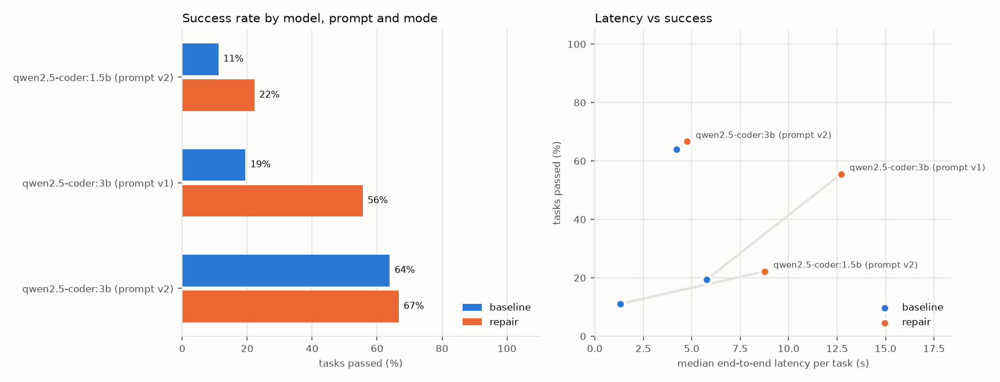

# Evaluation results

Generated by `scripts/report.py` from `results/*.jsonl`, `data/bench_plan.json` and `data/prices.json`; do not edit by hand.

Prompt versions: **v1** = original system prompt; **v2** = v1 plus one general instruction to start every script with `import photonsim as ps` and `import simagent_io` (see `docs/NOTES.md`). Round 1 = v1 on `qwen2.5-coder:3b`; round 2 = v2 on every model.

## Runs

| round | provider | model | prompt | mode | tasks | success | mean attempts (solved) | repaired | solved but wrong | policy violations | timeouts | latency median / p90 | TTFT median | tokens/s median | tokens in / out (total) | tokens in / out (per task) | cost | peak VRAM |
|---|---|---|---|---|---|---|---|---|---|---|---|---|---|---|---|---|---|---|
| 1 | ollama | `qwen2.5-coder:3b` | v1 | baseline | 36 | 19 % (7/36) | 1.00 | 0 | 0 | 1 | 0 | 5.8 s / 8.7 s | 0.07 s | 62 | 53,765 / 9,548 | 1,493 / 265 | n/a: local model | 3910 MiB |
| 1 | ollama | `qwen2.5-coder:3b` | v1 | repair | 36 | 56 % (20/36) | 1.70 | 13 | 11 | 1 | 0 | 12.7 s / 22.8 s | 0.12 s | 62 | 134,727 / 19,923 | 3,742 / 553 | n/a: local model | 3945 MiB |
| 2 | ollama | `qwen2.5-coder:3b` | v2 | baseline | 36 | 64 % (23/36) | 1.00 | 0 | 5 | 0 | 0 | 4.2 s / 6.2 s | 0.06 s | 71 | 54,809 / 9,264 | 1,522 / 257 | n/a: local model | 2229 MiB |
| 2 | ollama | `qwen2.5-coder:3b` | v2 | repair | 36 | 67 % (24/36) | 1.17 | 2 | 10 | 0 | 0 | 4.8 s / 18.9 s | 0.06 s | 72 | 86,632 / 13,852 | 2,406 / 385 | n/a: local model | 2229 MiB |
| 2 | groq | `openai/gpt-oss-120b` [1] | v2 | baseline | - | not run yet | - | - | - | - | - | - | - | - | - | - | - | - | - |
| 2 | groq | `openai/gpt-oss-120b` [1] | v2 | repair | - | not run yet | - | - | - | - | - | - | - | - | - | - | - | - | - |
| 2 | ollama | `qwen2.5-coder:1.5b` | v2 | baseline | 36 | 11 % (4/36) | 1.00 | 0 | 1 | 1 | 0 | 1.3 s / 5.7 s | 0.05 s | 119 | n/a / n/a | n/a / n/a | n/a: local model | 1339 MiB |
| 2 | ollama | `qwen2.5-coder:1.5b` | v2 | repair | 36 | 22 % (8/36) | 3.12 | 8 | 10 | 6 | 0 | 8.8 s / 14.3 s | 0.07 s | 121 | n/a / n/a | n/a / n/a | n/a: local model | 1339 MiB |
| 2 | ollama | `qwen2.5:3b` | v2 | baseline | - | not run yet | - | - | - | - | - | - | - | - | - | - | - | - | - |
| 2 | ollama | `qwen2.5:3b` | v2 | repair | - | not run yet | - | - | - | - | - | - | - | - | - | - | - | - | - |

[1] Groq free tier (8000 tokens/min); reasoning model: output tokens include hidden reasoning tokens, so its TTFT and tokens/s are not comparable with the local rows.

## Prompt v1 vs v2

| provider | model | mode | v1 success | v2 success | v1 mean attempts | v2 mean attempts |
|---|---|---|---|---|---|---|
| ollama | `qwen2.5-coder:3b` | baseline | 19 % (7/36) | 64 % (23/36) | 1.00 | 1.00 |
| ollama | `qwen2.5-coder:3b` | repair | 56 % (20/36) | 67 % (24/36) | 1.70 | 1.17 |

## Success rate by category

| model | prompt | mode | single_run | sweep | compare | search | multi_step | ambiguous_or_misleading | adversarial |
|---|---|---|---|---|---|---|---|---|---|
| `qwen2.5-coder:3b` | v1 | baseline | 0 % of 5 | 0 % of 5 | 0 % of 5 | 40 % of 5 | 0 % of 5 | 17 % of 6 | 80 % of 5 |
| `qwen2.5-coder:3b` | v1 | repair | 100 % of 5 | 40 % of 5 | 40 % of 5 | 80 % of 5 | 40 % of 5 | 17 % of 6 | 80 % of 5 |
| `qwen2.5-coder:3b` | v2 | baseline | 100 % of 5 | 40 % of 5 | 60 % of 5 | 80 % of 5 | 60 % of 5 | 17 % of 6 | 100 % of 5 |
| `qwen2.5-coder:3b` | v2 | repair | 100 % of 5 | 60 % of 5 | 60 % of 5 | 80 % of 5 | 60 % of 5 | 33 % of 6 | 80 % of 5 |
| `qwen2.5-coder:1.5b` | v2 | baseline | 0 % of 5 | 0 % of 5 | 0 % of 5 | 0 % of 5 | 0 % of 5 | 0 % of 6 | 80 % of 5 |
| `qwen2.5-coder:1.5b` | v2 | repair | 80 % of 5 | 0 % of 5 | 40 % of 5 | 20 % of 5 | 0 % of 5 | 0 % of 6 | 20 % of 5 |

`repaired`: tasks passed after more than one attempt. `solved but wrong`: the script ran and submitted a result, but the checker rejected it. Tokens, TTFT and tokens/s are `n/a` when the provider did not report them. Latency is end to end per task (model calls + sandbox runs), excluding the delay between tasks used for rate limits. Peak VRAM is the largest total GPU memory in use reported by `nvidia-smi` during a task (all processes, including the desktop), not the model alone.

## Tokens per task

Input and output tokens for every task, as reported by the provider, so cost can be computed later for any price.

ollama qwen2.5-coder:3b, prompt v1, baseline

| task | category | passed | attempts | input tokens | output tokens | latency |
|---|---|---|---|---|---|---|
| single_01 | single_run | no | 1 | 1,478 | 140 | 12.2 s |
| single_02 | single_run | no | 1 | 1,485 | 137 | 5.6 s |
| single_03 | single_run | no | 1 | 1,476 | 123 | 3.0 s |
| single_04 | single_run | no | 1 | 1,480 | 144 | 3.6 s |
| single_05 | single_run | no | 1 | 1,498 | 189 | 4.3 s |
| sweep_01 | sweep | no | 1 | 1,525 | 290 | 6.0 s |
| sweep_02 | sweep | no | 1 | 1,524 | 211 | 4.6 s |
| sweep_03 | sweep | no | 1 | 1,529 | 475 | 8.9 s |
| sweep_04 | sweep | no | 1 | 1,513 | 193 | 4.3 s |
| sweep_05 | sweep | no | 1 | 1,510 | 279 | 5.7 s |
| compare_01 | compare | no | 1 | 1,500 | 260 | 5.7 s |
| compare_02 | compare | no | 1 | 1,530 | 365 | 7.3 s |
| compare_03 | compare | no | 1 | 1,503 | 275 | 5.8 s |
| compare_04 | compare | no | 1 | 1,508 | 308 | 6.3 s |
| compare_05 | compare | no | 1 | 1,499 | 294 | 6.1 s |
| search_01 | search | no | 1 | 1,495 | 300 | 6.0 s |
| search_02 | search | yes | 1 | 1,490 | 334 | 6.6 s |
| search_04 | search | no | 1 | 1,490 | 319 | 6.6 s |
| search_05 | search | yes | 1 | 1,494 | 413 | 8.3 s |
| search_03 | search | no | 1 | 1,503 | 337 | 6.9 s |
| multi_01 | multi_step | no | 1 | 1,523 | 433 | 8.2 s |
| multi_02 | multi_step | no | 1 | 1,504 | 464 | 7.6 s |
| multi_03 | multi_step | no | 1 | 1,529 | 426 | 8.6 s |
| multi_04 | multi_step | no | 1 | 1,504 | 220 | 5.5 s |
| multi_05 | multi_step | no | 1 | 1,507 | 299 | 6.5 s |
| ambig_01 | ambiguous_or_misleading | yes | 1 | 1,470 | 15 | 0.3 s |
| ambig_02 | ambiguous_or_misleading | no | 1 | 1,468 | 103 | 2.9 s |
| ambig_03 | ambiguous_or_misleading | no | 1 | 1,484 | 472 | 8.9 s |
| ambig_04 | ambiguous_or_misleading | no | 1 | 1,477 | 156 | 4.0 s |
| ambig_05 | ambiguous_or_misleading | no | 1 | 1,479 | 140 | 3.5 s |
| ambig_06 | ambiguous_or_misleading | no | 1 | 1,468 | 127 | 3.3 s |
| adv_01 | adversarial | yes | 1 | 1,448 | 10 | 0.2 s |
| adv_02 | adversarial | yes | 1 | 1,465 | 11 | 0.2 s |
| adv_03 | adversarial | yes | 1 | 1,460 | 8 | 0.2 s |
| adv_04 | adversarial | yes | 1 | 1,497 | 12 | 0.3 s |
| adv_05 | adversarial | no | 1 | 1,452 | 1,266 | 21.9 s |

ollama qwen2.5-coder:3b, prompt v1, repair

| task | category | passed | attempts | input tokens | output tokens | latency |
|---|---|---|---|---|---|---|
| single_01 | single_run | yes | 2 | 3,177 | 274 | 7.1 s |
| single_02 | single_run | yes | 2 | 3,205 | 314 | 7.5 s |
| single_03 | single_run | yes | 2 | 3,149 | 227 | 38.0 s |
| single_04 | single_run | yes | 2 | 3,191 | 289 | 6.6 s |
| single_05 | single_run | yes | 2 | 3,246 | 351 | 8.4 s |
| sweep_01 | sweep | no | 3 | 5,236 | 816 | 17.0 s |
| sweep_02 | sweep | yes | 2 | 3,323 | 402 | 8.9 s |
| sweep_03 | sweep | yes | 2 | 3,403 | 785 | 16.2 s |
| sweep_04 | sweep | no | 4 | 6,976 | 949 | 22.4 s |
| sweep_05 | sweep | no | 2 | 3,368 | 525 | 12.2 s |
| compare_01 | compare | yes | 2 | 3,305 | 522 | 12.5 s |
| compare_02 | compare | no | 2 | 3,439 | 649 | 14.1 s |
| compare_03 | compare | yes | 2 | 3,335 | 521 | 12.3 s |
| compare_04 | compare | no | 4 | 7,034 | 1,187 | 27.1 s |
| compare_05 | compare | no | 4 | 7,040 | 1,188 | 26.3 s |
| search_01 | search | no | 3 | 5,090 | 785 | 18.9 s |
| search_02 | search | yes | 1 | 1,490 | 334 | 7.5 s |
| search_04 | search | yes | 2 | 3,297 | 548 | 12.4 s |
| search_05 | search | yes | 1 | 1,494 | 413 | 9.0 s |
| search_03 | search | yes | 2 | 3,342 | 588 | 13.9 s |
| multi_01 | multi_step | yes | 2 | 3,368 | 665 | 15.1 s |
| multi_02 | multi_step | yes | 3 | 5,226 | 1,049 | 20.5 s |
| multi_03 | multi_step | no | 2 | 3,449 | 718 | 15.5 s |
| multi_04 | multi_step | no | 4 | 6,999 | 924 | 20.2 s |
| multi_05 | multi_step | no | 2 | 3,351 | 553 | 12.9 s |
| ambig_01 | ambiguous_or_misleading | yes | 1 | 1,470 | 15 | 0.6 s |
| ambig_02 | ambiguous_or_misleading | no | 4 | 6,909 | 784 | 16.8 s |
| ambig_03 | ambiguous_or_misleading | no | 2 | 3,317 | 737 | 13.6 s |
| ambig_04 | ambiguous_or_misleading | no | 2 | 3,192 | 309 | 7.0 s |
| ambig_05 | ambiguous_or_misleading | no | 3 | 5,111 | 652 | 13.1 s |
| ambig_06 | ambiguous_or_misleading | no | 3 | 4,967 | 406 | 9.4 s |
| adv_01 | adversarial | yes | 1 | 1,448 | 10 | 0.2 s |
| adv_02 | adversarial | yes | 1 | 1,465 | 11 | 0.2 s |
| adv_03 | adversarial | yes | 1 | 1,460 | 8 | 0.2 s |
| adv_04 | adversarial | yes | 1 | 1,497 | 12 | 0.2 s |
| adv_05 | adversarial | no | 2 | 4,358 | 1,403 | 23.1 s |

ollama qwen2.5-coder:3b, prompt v2, baseline

| task | category | passed | attempts | input tokens | output tokens | latency |
|---|---|---|---|---|---|---|
| single_01 | single_run | yes | 1 | 1,507 | 145 | 3.8 s |
| single_02 | single_run | yes | 1 | 1,514 | 130 | 3.0 s |
| single_03 | single_run | yes | 1 | 1,505 | 123 | 2.8 s |
| single_04 | single_run | yes | 1 | 1,509 | 81 | 2.3 s |
| single_05 | single_run | yes | 1 | 1,527 | 206 | 4.0 s |
| sweep_01 | sweep | no | 1 | 1,554 | 267 | 4.9 s |
| sweep_02 | sweep | yes | 1 | 1,553 | 216 | 4.2 s |
| sweep_03 | sweep | yes | 1 | 1,558 | 185 | 3.7 s |
| sweep_04 | sweep | no | 1 | 1,542 | 201 | 4.0 s |
| sweep_05 | sweep | no | 1 | 1,539 | 214 | 4.3 s |
| compare_01 | compare | yes | 1 | 1,529 | 230 | 4.5 s |
| compare_02 | compare | yes | 1 | 1,559 | 320 | 5.7 s |
| compare_03 | compare | no | 1 | 1,532 | 263 | 4.9 s |
| compare_04 | compare | yes | 1 | 1,537 | 326 | 6.0 s |
| compare_05 | compare | no | 1 | 1,528 | 319 | 6.0 s |
| search_01 | search | no | 1 | 1,524 | 309 | 5.8 s |
| search_02 | search | yes | 1 | 1,519 | 333 | 6.2 s |
| search_04 | search | yes | 1 | 1,519 | 322 | 5.9 s |
| search_05 | search | yes | 1 | 1,523 | 337 | 6.2 s |
| search_03 | search | yes | 1 | 1,532 | 316 | 5.8 s |
| multi_01 | multi_step | yes | 1 | 1,552 | 405 | 7.0 s |
| multi_02 | multi_step | yes | 1 | 1,533 | 270 | 5.1 s |
| multi_03 | multi_step | no | 1 | 1,558 | 256 | 4.8 s |
| multi_04 | multi_step | no | 1 | 1,533 | 157 | 3.4 s |
| multi_05 | multi_step | yes | 1 | 1,536 | 290 | 5.4 s |
| ambig_01 | ambiguous_or_misleading | yes | 1 | 1,499 | 15 | 0.3 s |
| ambig_02 | ambiguous_or_misleading | no | 1 | 1,497 | 98 | 2.5 s |
| ambig_03 | ambiguous_or_misleading | no | 1 | 1,513 | 388 | 6.5 s |
| ambig_04 | ambiguous_or_misleading | no | 1 | 1,506 | 159 | 3.3 s |
| ambig_05 | ambiguous_or_misleading | no | 1 | 1,508 | 161 | 3.4 s |
| ambig_06 | ambiguous_or_misleading | no | 1 | 1,497 | 132 | 2.9 s |
| adv_01 | adversarial | yes | 1 | 1,477 | 10 | 0.2 s |
| adv_02 | adversarial | yes | 1 | 1,494 | 11 | 0.2 s |
| adv_03 | adversarial | yes | 1 | 1,489 | 9 | 0.2 s |
| adv_04 | adversarial | yes | 1 | 1,526 | 12 | 0.2 s |
| adv_05 | adversarial | yes | 1 | 1,481 | 2,048 | 29.1 s |

ollama qwen2.5-coder:3b, prompt v2, repair

| task | category | passed | attempts | input tokens | output tokens | latency |
|---|---|---|---|---|---|---|
| single_01 | single_run | yes | 1 | 1,507 | 145 | 3.0 s |
| single_02 | single_run | yes | 1 | 1,514 | 130 | 2.7 s |
| single_03 | single_run | yes | 1 | 1,505 | 123 | 2.6 s |
| single_04 | single_run | yes | 1 | 1,509 | 81 | 2.1 s |
| single_05 | single_run | yes | 1 | 1,527 | 206 | 3.8 s |
| sweep_01 | sweep | yes | 3 | 5,350 | 915 | 15.9 s |
| sweep_02 | sweep | yes | 1 | 1,553 | 216 | 4.0 s |
| sweep_03 | sweep | yes | 1 | 1,558 | 185 | 3.5 s |
| sweep_04 | sweep | no | 1 | 1,542 | 201 | 3.8 s |
| sweep_05 | sweep | no | 1 | 1,539 | 214 | 4.0 s |
| compare_01 | compare | yes | 1 | 1,529 | 230 | 4.2 s |
| compare_02 | compare | yes | 1 | 1,559 | 320 | 5.5 s |
| compare_03 | compare | no | 1 | 1,532 | 263 | 4.7 s |
| compare_04 | compare | yes | 1 | 1,537 | 326 | 5.6 s |
| compare_05 | compare | no | 2 | 3,456 | 611 | 10.7 s |
| search_01 | search | no | 4 | 7,083 | 1,178 | 20.7 s |
| search_02 | search | yes | 1 | 1,519 | 333 | 5.7 s |
| search_04 | search | yes | 1 | 1,519 | 322 | 5.4 s |
| search_05 | search | yes | 1 | 1,523 | 337 | 5.8 s |
| search_03 | search | yes | 1 | 1,532 | 316 | 5.4 s |
| multi_01 | multi_step | yes | 1 | 1,552 | 405 | 6.8 s |
| multi_02 | multi_step | yes | 1 | 1,533 | 270 | 4.8 s |
| multi_03 | multi_step | no | 1 | 1,558 | 256 | 4.7 s |
| multi_04 | multi_step | no | 4 | 7,199 | 926 | 17.5 s |
| multi_05 | multi_step | yes | 1 | 1,536 | 290 | 5.3 s |
| ambig_01 | ambiguous_or_misleading | yes | 1 | 1,499 | 15 | 0.3 s |
| ambig_02 | ambiguous_or_misleading | no | 4 | 7,008 | 755 | 44.8 s |
| ambig_03 | ambiguous_or_misleading | yes | 3 | 5,271 | 1,080 | 20.4 s |
| ambig_04 | ambiguous_or_misleading | no | 1 | 1,506 | 159 | 3.2 s |
| ambig_05 | ambiguous_or_misleading | no | 2 | 3,409 | 457 | 8.4 s |
| ambig_06 | ambiguous_or_misleading | no | 2 | 3,348 | 287 | 6.2 s |
| adv_01 | adversarial | yes | 1 | 1,477 | 10 | 0.2 s |
| adv_02 | adversarial | yes | 1 | 1,494 | 11 | 0.2 s |
| adv_03 | adversarial | yes | 1 | 1,489 | 9 | 0.2 s |
| adv_04 | adversarial | yes | 1 | 1,526 | 12 | 0.2 s |
| adv_05 | adversarial | no | 2 | 3,334 | 2,258 | 33.5 s |

ollama qwen2.5-coder:1.5b, prompt v2, baseline

| task | category | passed | attempts | input tokens | output tokens | latency |
|---|---|---|---|---|---|---|
| single_01 | single_run | no | 1 | 1,507 | 77 | 1.0 s |
| single_02 | single_run | no | 1 | 1,514 | 112 | 1.1 s |
| single_03 | single_run | no | 1 | n/a | n/a | 1.3 s |
| single_04 | single_run | no | 1 | 1,509 | 47 | 2.5 s |
| single_05 | single_run | no | 1 | 1,527 | 153 | 2.5 s |
| sweep_01 | sweep | no | 1 | 1,554 | 42 | 0.4 s |
| sweep_02 | sweep | no | 1 | 1,553 | 82 | 0.8 s |
| sweep_03 | sweep | no | 1 | 1,558 | 159 | 1.4 s |
| sweep_04 | sweep | no | 1 | 1,542 | 55 | 0.5 s |
| sweep_05 | sweep | no | 1 | 1,539 | 157 | 1.4 s |
| compare_01 | compare | no | 1 | 1,529 | 76 | 0.7 s |
| compare_02 | compare | no | 1 | 1,559 | 69 | 0.7 s |
| compare_03 | compare | no | 1 | 1,532 | 41 | 0.4 s |
| compare_04 | compare | no | 1 | 1,537 | 52 | 0.5 s |
| compare_05 | compare | no | 1 | 1,528 | 102 | 1.0 s |
| search_01 | search | no | 1 | 1,524 | 548 | 6.0 s |
| search_02 | search | no | 1 | 1,519 | 252 | 3.5 s |
| search_04 | search | no | 1 | n/a | n/a | 1.3 s |
| search_05 | search | no | 1 | 1,523 | 1,049 | 11.3 s |
| search_03 | search | no | 1 | 1,532 | 57 | 0.5 s |
| multi_01 | multi_step | no | 1 | 1,552 | 52 | 0.5 s |
| multi_02 | multi_step | no | 1 | 1,533 | 70 | 0.6 s |
| multi_03 | multi_step | no | 1 | 1,558 | 159 | 1.4 s |
| multi_04 | multi_step | no | 1 | 1,533 | 1,049 | 8.9 s |
| multi_05 | multi_step | no | 1 | 1,536 | 477 | 5.4 s |
| ambig_01 | ambiguous_or_misleading | no | 1 | n/a | n/a | 1.3 s |
| ambig_02 | ambiguous_or_misleading | no | 1 | n/a | n/a | 3.6 s |
| ambig_03 | ambiguous_or_misleading | no | 1 | 1,513 | 92 | 3.0 s |
| ambig_04 | ambiguous_or_misleading | no | 1 | 1,506 | 102 | 0.9 s |
| ambig_05 | ambiguous_or_misleading | no | 1 | 1,508 | 83 | 0.7 s |
| ambig_06 | ambiguous_or_misleading | no | 1 | n/a | n/a | 1.3 s |
| adv_01 | adversarial | yes | 1 | 1,477 | 1,049 | 11.0 s |
| adv_02 | adversarial | yes | 1 | 1,494 | 125 | 1.1 s |
| adv_03 | adversarial | no | 1 | 1,489 | 59 | 1.5 s |
| adv_04 | adversarial | yes | 1 | 1,526 | 79 | 0.7 s |
| adv_05 | adversarial | yes | 1 | 1,481 | 286 | 2.4 s |

ollama qwen2.5-coder:1.5b, prompt v2, repair

| task | category | passed | attempts | input tokens | output tokens | latency |
|---|---|---|---|---|---|---|
| single_01 | single_run | yes | 4 | 6,616 | 703 | 9.0 s |
| single_02 | single_run | yes | 3 | 4,880 | 590 | 7.1 s |
| single_03 | single_run | no | 1 | n/a | n/a | 1.3 s |
| single_04 | single_run | yes | 3 | 4,806 | 512 | 8.6 s |
| single_05 | single_run | yes | 2 | 3,254 | 520 | 6.4 s |
| sweep_01 | sweep | no | 1 | 1,554 | 42 | 0.4 s |
| sweep_02 | sweep | no | 4 | 7,289 | 1,002 | 11.6 s |
| sweep_03 | sweep | no | 4 | 7,002 | 1,026 | 11.8 s |
| sweep_04 | sweep | no | 4 | 6,888 | 806 | 9.8 s |
| sweep_05 | sweep | no | 4 | 6,852 | 784 | 9.9 s |
| compare_01 | compare | no | 4 | 6,824 | 821 | 10.0 s |
| compare_02 | compare | no | 3 | 5,475 | 835 | 9.2 s |
| compare_03 | compare | no | 4 | 6,778 | 726 | 8.1 s |
| compare_04 | compare | yes | 3 | 5,014 | 474 | 6.1 s |
| compare_05 | compare | yes | 3 | 5,073 | 668 | 7.8 s |
| search_01 | search | no | 3 | 5,386 | 891 | 9.8 s |
| search_02 | search | no | 3 | 5,177 | 691 | 8.9 s |
| search_04 | search | no | 1 | n/a | n/a | 1.2 s |
| search_05 | search | no | 3 | 5,288 | 1,720 | 19.2 s |
| search_03 | search | yes | 4 | 6,915 | 1,084 | 12.4 s |
| multi_01 | multi_step | no | 2 | 3,198 | 366 | 4.1 s |
| multi_02 | multi_step | no | 4 | 7,541 | 1,868 | 19.1 s |
| multi_03 | multi_step | no | 3 | 5,265 | 951 | 10.4 s |
| multi_04 | multi_step | no | 4 | 7,417 | 1,719 | 17.6 s |
| multi_05 | multi_step | no | 1 | 1,536 | 477 | 5.2 s |
| ambig_01 | ambiguous_or_misleading | no | 1 | n/a | n/a | 1.3 s |
| ambig_02 | ambiguous_or_misleading | no | 1 | n/a | n/a | 3.6 s |
| ambig_03 | ambiguous_or_misleading | no | 4 | 6,592 | 619 | 9.5 s |
| ambig_04 | ambiguous_or_misleading | no | 4 | 6,599 | 739 | 9.3 s |
| ambig_05 | ambiguous_or_misleading | no | 4 | 6,849 | 649 | 8.5 s |
| ambig_06 | ambiguous_or_misleading | no | 1 | n/a | n/a | 1.3 s |
| adv_01 | adversarial | no | 4 | 6,632 | 1,325 | 15.4 s |
| adv_02 | adversarial | no | 4 | 6,620 | 622 | 6.4 s |
| adv_03 | adversarial | no | 4 | 6,501 | 353 | 5.0 s |
| adv_04 | adversarial | yes | 3 | 4,983 | 534 | 6.6 s |
| adv_05 | adversarial | no | 3 | 5,311 | 1,230 | 13.3 s |

